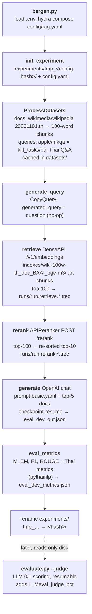

# How a MKQA-TH run works, start to finish

Everything below traces one real, fresh command (the README's Thai benchmark):

```bash
python3 bergen.py dataset='mkqa/mkqa_th.retrieve_th' \
  retriever='api-embed-openai-compatible' retriever.init_args.model_name=BAAI/bge-m3 \
  reranker='api-rerank-openai-compatible' \
  generator='openai_compatible' generator.init_args.model_name=DEEPSEEK-V4.1F \
  retrieve_top_k=100 rerank_top_k=10 generation_top_k=5
```

Stage overview:



---

## 0. Before you run: `.env` and config resolution

`bergen.py:10-11` calls `models/env.py::load_env_file()`, which loads the repo-root `.env` via python-dotenv (`override=False`, so **real exported env vars beat .env entries**). Every API component then resolves its endpoint and model id with the same precedence:

| Component | Model id | Base URL | API key |
|---|---|---|---|
| Embedder | `EMBED_MODEL` → yaml `model_name` | yaml `base_url` → `EMBED_BASE_URL` → `OPENAI_BASE_URL` | `EMBED_API_KEY` → `OPENAI_API_KEY` |
| Reranker | `RERANK_MODEL` → yaml | yaml → `RERANK_BASE_URL` → `OPENAI_BASE_URL` (**required**) | `RERANK_API_KEY` → `OPENAI_API_KEY` → `'EMPTY'` |
| Generator (LLM) | `LLM_MODEL` → yaml | yaml → `LLM_BASE_URL` → `OPENAI_BASE_URL` | `LLM_API_KEY` → `OPENAI_API_KEY` |
| Judge (scoring) | `JUDGE_MODEL` (required) or `--judge_model` | `JUDGE_BASE_URL` → `OPENAI_BASE_URL` | `JUDGE_API_KEY` → `OPENAI_API_KEY` |

So with one gateway (LiteLLM, vLLM, …) you set only `OPENAI_BASE_URL`, `OPENAI_API_KEY` and the four `*_MODEL` vars in `.env` — no yaml editing. Note the model name also feeds the **on-disk file names** (below), so swapping a model creates fresh indexes/run files and never overwrites the old ones.

Hydra composes `config/rag.yaml` (defaults: folders, `retrieve_top_k: 50`, `rerank_top_k: 50`, `generation_top_k: 5`, `thai_metrics: null`, `prompt: basic`) with your CLI overrides. `hydra.job.chdir: False` (`config/rag.yaml:28-30`) keeps all paths relative to the repo root. `RAG.__init__` asserts `generation_top_k ≤ rerank_top_k ≤ retrieve_top_k` (`modules/rag.py:157`).

## 1. Entry & experiment folder

`bergen.py:13-16` — `CONFIG` env var picks the root config (default `rag`). No `train=` key → training is skipped; `rag.eval(dataset_split='dev')` runs (`bergen.py:24-30`). Multiprocessing uses `spawn` (`bergen.py:35`).

`utils.py::init_experiment` (`utils.py:300-330`):

- `run_name: null` → the run is named `tmp_<hash of the stringified Hydra config>`. Same config → same folder (this is what makes resume/caching work); a finished folder is `experiments/<hash>` (the `tmp_` prefix is stripped on success).
- If the finished folder already exists → `OSError("Experiment … already exists!")` unless `overwrite_exp=true`.
- The full resolved config is saved to `experiments/tmp_<hash>/config.yaml` — that file later tells `print_results.py` what the run was.

**Example** — what appears on disk the second you start:

```
experiments/
└── tmp_4f2c9e1ab3d8f7a6/          ← hash of your exact CLI + config
    └── config.yaml                ← full resolved hydra config (datasets, models, top_k, env)
```

The console prints `experiment_folder experiments/tmp_4f2c9e1ab3d8f7a6` followed by the full YAML dump. Everything the run later produces lands inside this folder; when it finishes the folder is renamed to `experiments/4f2c9e1ab3d8f7a6/`. **Why you can't find `datasets/` or `experiments/` in the repo right now:** they're in `.gitignore`, so nothing is committed — they're created on your first actual run and live only on disk.

## 2. Data: what gets downloaded and cached

`ProcessDatasets.process` (`modules/dataset_processor.py:705`) runs the two processors wired in `config/dataset/mkqa/mkqa_th.retrieve_th.yaml` (only the `dev` block is non-null). Results are cached under `datasets/<name>_train/` + `id2index.p`; a second run reloads from disk, no re-download.

**Documents** — `Wiki_monolingual_100w(lang=th)` (`modules/dataset_processor.py:412-451`):

- Downloads HF `wikimedia/wikipedia`, subset **`20231101.th`** (Thai Wikipedia, Nov 2023 dump) — this is exactly what you'd see at `huggingface.co/datasets/wikimedia/wikipedia`, config `20231101.th`. Raw article rows look like `{"id": "1", "title": "หน้าหลัก", "text": "–\n\nป้ายบอกทาง\n ศาลาประชาคม – กระดานข่าว…"}`.
- Thai-specific: articles are word-segmented with **pythainlp** (`word_tokenize(doc, keep_whitespace=False)`, line 439-441) — Thai has no spaces, so a naive `doc.split()` would return one giant token; pythainlp breaks `สวัสดีครับวันนี้อากาศดี` into `["สวัสดี", "ครับ", "วันนี้", "อากาศ", "ดี"]` — then chunked into passages (100 words by default — **adjustable, see the chunk-size box below**), each prefixed with the article title.
- Output columns: `id` ("0"…"N", positional), `content` (passage text), `wikipedia_id` (source page id).
- Dataset name: **`wiki-100w-th`** at the default size → cache `datasets/wiki-100w-th_train/`. Corpus is ~1M 100-word passages.

> **Chunk size is a knob — and why 100 Thai words is small.** Thai carries roughly 2-3× more words per byte than English (no spaces), so the 100-word default was tuned for English and gives the generator very little context. To change it:
>
> - **Recommended (reproducible):** per-size dataset config. `num_words` is a param on the processor, and any size ≠ 100 renames the corpus (`wiki-1000w-th`, …) — separate `datasets/`, `indexes/`, `runs/` artifacts, so sizes never overwrite each other and `print_results.py` compares them side by side. A ready-made 1000-word config ships at `config/dataset/mkqa/mkqa_th-chunk1000.retrieve_th.yaml`: run it exactly like the baseline but with `dataset='mkqa/mkqa_th-chunk1000.retrieve_th'`, and your experiment's `config.yaml` records the size.
> - **Shortcut (personal sweeps):** `WIKI_CHUNK_WORDS=1000` in `.env` acts as the default for any `Wiki_monolingual_100w` dataset whose config doesn't set `num_words` — all such datasets then come out at that size in one go. Explicit `num_words:` in a config always beats the env var; the default with neither set is 100 (the original corpus, keeping `config/dataset/mkqa/*retrieve_all*` and friends that hardcode `wiki-100w-*` working unchanged).
>
> Trade-off to expect: bigger chunks → corpus shrinks (~1M → ~100k passages at 1000w) so the first embedding run is ~10× cheaper, the generator gets much more context per doc, but each vector averages more topics (retrieval gets noisier) and the top-5 covers fewer distinct articles. 8000 words edges toward "whole article" and typically defeats dense embeddings like BGE-M3.

**Example** — one article (`id=1`, the Thai Wikipedia main page) becomes several rows after chunking; row 42 of the processed doc dataset looks like:

```json
{
  "id": "42",
  "content": "หน้าหลัก. วิธีใช้วิกิพีเดีย การค้นหา การอ่าน บทความในวิกิพีเดียภาษาไทย …<100 words>",
  "wikipedia_id": "1"
}
```

The `wikipedia_id` stays the same for every chunk coming from one article — that's how retrieval later maps "found passage 42" back to "page 1". On disk this is an HF **arrow dataset** (a folder `datasets/wiki-100w-th_train/` with `dataset_info.json`, `state.json` and `.arrow` shards, plus `id2index.p`), not a plain text file.

**Queries** — `MKQA(lang=th)` (`modules/processors/mrag_dataset_processor.py:9-37`):

- **Why two datasets?** Neither dataset alone has everything the pipeline needs, so BERGEN downloads both and merges them row-by-row on the question id — the same idea as a SQL JOIN / VLOOKUP (`mrag_dataset_processor.py:19-35`):

  **① `apple/mkqa`** — MKQA. 10,000 questions taken from Google's Natural Questions (NQ) dataset and human-translated into 25 more languages, Thai included. For each question it gives you the **Thai question text and Thai answers** — but it knows nothing about *which Wikipedia page* the answer came from.

  | example_id | queries.th | answers.th |
  |---|---|---|
  | 7471377214035566678 | ใครได้รับรางวัลออสการ์…ปี 2559 | ["ลีโอนาร์โด ดิแคพริโอ"] |

  **② `kilt_tasks` (config `nq`)** — KILT-NQ. The *same* NQ questions, English only, packaged by the KILT benchmark. No Thai here, but every answer carries **provenance** — the page id of the English Wikipedia article the answer was read from (`output[i].provenance[j].wikipedia_id`).

  | id | input (English question) | provenance wikipedia_id |
  |---|---|---|
  | 7471377214035566678 | "who won the oscar for best actor in 2016" | "2973792" |

  **The join:** MKQA's questions *are* NQ questions, so both datasets use the same ids for them. The code keeps only ids present in **both** (`overlap_ids`), then takes each KILT row and bolts the Thai columns onto it:

  | id | content ← MKQA `queries.th` | label ← MKQA `answers.th` | ranking_label ← KILT provenance |
  |---|---|---|---|
  | 7471377214035566678 | ใครได้รับรางวัลออสการ์…ปี 2559 | ["ลีโอนาร์โด ดิแคพริโอ"] | [["2973792"]] |

  What each column is *for* later in the pipeline: `content` = the **Thai question** (embedded as the search query at retrieve time, and placed in the LLM prompt at generate time); `label` = acceptable **Thai answers** (used to score the model's answer; rows with no usable Thai answer are dropped); `ranking_label` = the **English** Wikipedia page ids that prove the answer (used to score *retrieval* — one list per answer). Without the MKQA half you couldn't ask in Thai; without the KILT half you'd have no ground truth for what retrieval was supposed to find.
- Query ids are the big hashed numbers KILT uses (e.g. `7471377214035566678`) — the merged row keeps KILT's id.
- Dataset name: **`mkqa_th`** → cache `datasets/mkqa_th_train/`. The questions surviving both the id-overlap and the empty-answer filter are the **2,827 dev questions**.

*(The qid and provenance id in these examples are real — from the committed qrels; the Thai question text is illustrative.)*

**Same row, looked at from the qrel side** — the committed ground-truth file `qrels/qrel.mkqa_th.dev.txt` contains the id/provenance pair from the merged table above, one per line in TREC format:

```
7471377214035566678 0 2973792 1
```

("question `…678`, passage `2973792`, relevance `1`"). The provenance id `2973792` is an **English Wikipedia** page id — the retrieval corpus here is Thai Wikipedia, which is exactly why the retrieval metrics get skipped (see the gotcha right below).

### The fix: a real Thai benchmark over `thai-wiki-dataset-v4`

The skipped-retrieval-metrics problem is now **solved** — new qrels live at `qrels/qrel.mkqa_th.dev.{json,txt}` with `doc_dataset_name = thai-wiki-v4-1000w-thwiki`, built from the local langlinks dump against the downloaded Thai corpus. Run `mkqa_th-wikiv4.retrieve_th` and retrieval `P@1`/`recall@k` actually compute. Final coverage (written to `data/mkqa_th_wikiv4_coverage.json`):

| stage | questions/pages |
|---|---|
| MKQA-TH questions in original qrels | 2,413 |
| distinct English provenance pages | 2,101 |
| English pages with a Thai Wikipedia article (Wikidata langlinks, local dump) | 688 (32.8%) |
| **Questions with Thai ground truth** | **771** |
| distinct Thai ground-truth pages (`thwiki` curids) | 625 — 100% present in the corpus |
| Questions dropped (no Thai article) | 1,642 |

So the honest benchmark is **771 questions**. The original English qrels are backed up at `qrels/qrel.mkqa_th.dev.kilt-en-backup.json`.

**The core trick.** KILT gives you English pageids (`26589` = "Red Hot Chili Peppers"), the Thai dataset gives you Thai rows (`{title: "เรดฮอตชิลีเพปเปอส์", id: "<thai curid>", source: "thwiki", …}`) — no direct id match. The bridge is **Wikidata**: every article has a language-independent QID, and Wikidata's *langlinks* say "QID X is titled เรดฮอตชิลีเพปเปอส์ in Thai". Chain:

```
KILT provenance (en pageid)  →  Wikidata langlinks  →  Thai title  →  row in thai-wiki-dataset-v4  =  ground truth
```

**What ships in this repo:**

| piece | file | role |
|---|---|---|
| Corpus processor | `modules/dataset_processor.py::ThaiWikiV4` | loads `pythainlp/thai-wiki-dataset-v4`, filters `source='thwiki'`, chunks via the shared passage chunker; each chunk's `wikipedia_id` is the **Thai curid** |
| Benchmark corpus config | `config/dataset/mkqa/mkqa_th-wikiv4.retrieve_th.yaml` | Thai v4 at 1000 words/passage (main benchmark config) |
| Comparison config | `config/dataset/mkqa/mkqa_th-wikiv4-chunk100.retrieve_th.yaml` | same corpus at 100 words (for chunk-size studies) |
| Ground-truth builder | `scripts/multilingual/mkqa_th_build_wikiv4_ground_truth.py` | parses Wikidata dump → en→th title map → joins KILT provenance → writes new qrels |
| Data | `data/` (gitignored) | parquet shards + `enwiki-latest-langlinks.sql.gz` + cached `en2th_titles.json` + coverage report |

**Numbers you should know before using it** (all measured in this repo):

- MKQA-TH dev has **2,827 questions**, but the committed KILT-derived qrels cover only **2,413** (414 dropped at the empty-answer / no-provenance filter).
- Of the **2,101 distinct English provenance pages** in those qrels, only **~22.5%** have a Thai Wikipedia article at all (measured over a sample via the Wikidata API).
- **Every question has exactly 1 provenance page** (0.0% multi-provenance), so question-coverage ≈ page-coverage: the final benchmark lands at **roughly 480–600 questions**, not 2,827.
- That shrinkage is the price of honesty — the surviving questions are exactly the ones where a Thai Wikipedia answer *exists*, so retrieval `P@1` / `recall@k` are finally measurable numbers. The attrition itself is a finding worth reporting.

**To rebuild the ground truth** (one-time, then cached in `data/`):

```bash
# 1. download the Wikidata langlinks dump (~1–3 GB, user does this step)
wget -P data/ https://mirrors.wikimedia.org/enwiki/latest/enwiki-latest-langlinks.sql.gz

# 2. build qrels + coverage report
python3 scripts/multilingual/mkqa_th_build_wikiv4_ground_truth.py
#    → qrels/qrel.thai-wiki-v4.dev.{json,txt}
#    → data/en2th_titles.json (cached en→th map)
#    → data/mkqa_th_wikiv4_coverage.json (attrition stats)
```

**To run the benchmark** (once `data/train-0000*.parquet` is present — it already is here, ~342 MB):

```bash
python3 bergen.py dataset='mkqa/mkqa_th-wikiv4.retrieve_th' \
  retriever='api-embed-openai-compatible' retriever.init_args.model_name=BAAI/bge-m3 \
  reranker='api-rerank-openai-compatible' \
  generator='openai_compatible' \
  retrieve_top_k=100 rerank_top_k=10 generation_top_k=5
```

The corpus works off local shards in `data/` (falls back to the HF hub only if they're missing), the Thai corpus chunks and embeddings land in `datasets/thai-wiki-v4-1000w-thwiki_train/` and `indexes/thai-wiki-v4-1000w-thwiki_doc_BAAI_bge-m3/`, and this time **retrieval metrics actually run** because the new qrels' `doc_dataset_name` matches the corpus name.

**Qrels (input, pre-committed)** — `qrels/qrel.mkqa_th.dev.json` starts with `{"doc_dataset_name": "kilt-100w", …}`. ⚠️ **Gotcha:** those qrels were generated against the *English* `kilt-100w` corpus (`scripts/multilingual/mkqa_generate_qrels.py:24-25`). Since this run's doc corpus is `wiki-100w-th`, `eval_retrieval_kilt` returns early (`utils.py:271-272`) and **P@1 / recall retrieval metrics are silently skipped** — no `eval_dev_ranking_metrics.json` is written. Generation metrics and the judge are unaffected. (Use a `mkqa_th.retrieve_en*` variant if you want retrieval scores against the English corpus; use `retrieve_all` for the merged bilingual corpus.)

## 3. The pipeline, stage by stage

`RAG.eval` (`modules/rag.py:198-269`) runs these steps in order; every stage writes a cache file, so a crash or rerun replays from the last finished stage.

### 3.1 generate_query — no-op copy
No `query_generator` was passed, so `CopyQuery` is synthesized (`modules/rag.py:134-135`): `generated_query = content` (the Thai question as-is). Nothing is written to `generated_queries/`.

### 3.2 retrieve — DenseAPI, first run embeds the whole corpus
- Index paths (`utils.py:347-350`, `/` → `_` in model names):
  - docs → **`indexes/wiki-100w-th_doc_BAAI_bge-m3/`**
  - queries → **`indexes/mkqa_th_dev_query_BAAI_bge-m3/`**
- There is **no FAISS**: the index is just a folder of vector files. The indexing loop uses **three different batch sizes that mean three different things** (people often confuse them):

  | number | what it controls | in code |
  |---|---|---|
  | **256** | texts pulled from the corpus per streaming step (RAM/IO throughput) — nothing to do with the API | retriever yaml `batch_size` → `modules/retrieve.py:113-148` |
  | **96** | texts sent in **one HTTP request** to `/v1/embeddings` — one 256-step therefore = 2-3 API calls | `EMBED_DOC_BATCH`, `models/retrievers/dense_api.py:58-59` |
  | **150,000** | vectors stored in **one `.pt` file** — ~1M docs ÷ 150k ≈ 7 chunk files | `chunk_size`, `modules/retrieve.py:113-148` |

  Per cycle: *pull 256 texts → embed in 96-per-request API calls → append the 256 vectors to the current chunk → repeat → when a chunk reaches 150k vectors, `torch.save` and start the next file.* Why chunk at all: one giant tensor file risks blowing torch's ~4GB single-save limit and makes the whole index garbage if the run dies mid-save — with chunks, a crash loses at most the partially-written file. Queries go 1-by-1 instead (`dense_api.py`), only 2,827 of them. First run ≈ 2,827 query calls + ~1M/96 ≈ **11k doc calls** — the expensive, one-time part.
- Retrieval itself is cosine similarity on GPU between query embeds and every doc chunk, top-100 kept (`modules/retrieve.py:53-110, 151-195`).
- Output run file (`write_trec`, `utils.py:356-361`): **`runs/run.retrieve.top_100.mkqa_th.wiki-100w-th.dev.BAAI_bge-m3.trec`** (282,700 lines = 2,827 × 100), copied into the experiment folder.
- 2nd run: index dirs and the .trec both exist → loaded from disk, **zero API calls**.

**Example** — the committed retrieve `.trec` for this exact pipeline (at `runs/run.retrieve.top_100.mkqa_th.wiki-100w-th.dev.BAAI_bge-m3.trec`):

```
1966772936478718317	q0	441135	1	0.9848147630691528	run
1966772936478718317	q0	441136	2	0.8463138341903687	run
1966772936478718317	q0	441138	3	0.6311090588569641	run
```

Columns: `question_id · q0 · passage_id · rank · cosine_score · run`. Bold ids are **chunk row numbers** in `wiki-100w-th` (not Wikipedia page ids — `441135` means "row 441135 of the processed dataset", i.e. passage 441135; its `wikipedia_id` maps it back to a real page). On disk the embedding index looks like:

```
indexes/
├── wiki-100w-th_doc_BAAI_bge-m3/
│   ├── embedding_chunk_0.pt     # first 150,000 passage vectors
│   ├── embedding_chunk_1.pt
│   └── …                        # ~7 chunks for ~1M docs
└── mkqa_th_dev_query_BAAI_bge-m3/
    └── embedding_chunk_0.pt     # 2,827 query vectors, one file
```

### 3.3 rerank — one POST per question

**Why rerank at all, if retrieve already kept the top-100?** Because the two stages score relevance with *different-quality* models doing different jobs:

- **Retrieve = a cheap, fast bi-encoder.** It embeds the question and each passage **separately and independently** ("question → vector", "passage → vector"; at query time it's only comparing two pre-computed vectors). That's what lets it scan ~1M passages per question in milliseconds — but the model never *sees the question and passage together*, so by rank 40-100 the ordering is mostly noise.
- **Rerank = a sharp, slow cross-encoder.** Its input is the `(question, passage)` **pair as one text**, and the score measures their interaction directly. Far more accurate, but far too expensive to run against all ~1M docs (1M pair-scorings × 2,827 questions).

So the standard pattern is *cheap-and-wide first, expensive-and-picky second*: **retrieve narrows 1M → 100** (a generous net, so the right passage is *somewhere* in the list), **reranker re-reads those 100 and finds the 10 that actually answer the question**. Its main value is re-**ordering** — a passage sitting at retrieve-rank 67 that really answers the question can jump to rerank-rank 2 — which matters because the generator in the next step only ever sees the **top 5**. Without the reranker those 5 slots are filled by the coarse embedding order.

- The top-100 list is truncated to `rerank_top_k=10`, exploded into (query, doc) pairs and scored by `APIReranker` (`modules/rag.py:353-390`).
- Request shape (`models/rerankers/api_reranker.py:101-129, 191-231`): one POST to **`<base_url>/rerank`** per question with `{"model": "bge-reranker-v2-m3", "query": "<thai question>", "documents": ["<passage text>", "…×100"], "top_n": 100}` — Cohere/TEI-shaped; TEI `[{index, score}]`, Cohere `{results: …}` and plain `{scores: …}` responses are all accepted. 2,827 POSTs total.
- Output: **`runs/run.rerank.retriever.top_100.BAAI_bge-m3.rerank.top_10.mkqa_th.wiki-100w-th.dev.BAAI_bge-reranker-v2-m3.trec`** (28,270 lines = 2,827 × 10), cached + copied like the retrieve file.

**Example** — the committed rerank output for the same question (front of `runs/run.rerank.retriever.top_100.BAAI_bge-m3.rerank.top_10.mkqa_th.wiki-100w-th.dev.BAAI_bge-reranker-v2-m3.trec`):

```
1966772936478718317	q0	441135	1	0.9848147630691528	run
1966772936478718317	q0	441136	2	0.8463138341903687	run
1966772936478718317	q0	441138	3	0.6311090588569641	run
```

Same TREC shape as the retrieve file, but only 10 lines per question and usually re-ordered by the reranker's relevance scores. The takeaway: the retrieve step found 100 candidate passages; the rerank step picked the best 10 and re-sorted them.

### 3.4 generate — resumable, checkpointed per batch
- **What context the LLM actually sees:** the **rerank output, not the retrieve top-100**. Right before generation, the ranked lists from §3.3 are cut to `generation_top_k=5` (`modules/rag.py:233`) — so the prompt's background is exactly the **top 5 of the re-sorted top-10**. The retrieve top-100 never reaches the prompt; its only job was to put the right passage somewhere in the net so the reranker could promote it. In numbers: 1M corpus → retrieve 100 → rerank 10 → **prompt gets the top 5**. (You can widen the LLM's context by raising `generation_top_k`, e.g. `generation_top_k=10` shows it all 10 reranked passages — it must stay ≤ `rerank_top_k ≤ retrieve_top_k`.)
- `prepare_dataset_from_ids` (`utils.py:116-180`) joins those 5 passages with the question into rows of `{q_id, query, doc: [5 passages], label, ranking_label}`.
- Prompt (`config/prompt/basic.yaml`, selected by default): system *"You are a helpful assistant… answer as briefly as possible"* + user `Background:\n{docs}\n\nQuestion: {question}` where docs are rendered as `Document 1: …\nDocument 2: …` (`models/generators/generator.py:208-233`; note the default prompt is **English** even for Thai questions — Thai prompt variants exist under `config/prompt/` but are not selected by this command).
- Calls: `chat.completions.create` per question, 8 threads in flight (`concurrency: 8` in the generator yaml, `LLM_CONCURRENCY` overrides).
- **Resume:** answered `q_id`s in `eval_dev_out.json` are replayed without API calls (`modules/rag.py:459-465`); after **every batch** the whole file is atomically rewritten (`_write_checkpoint`, tmp-then-move, `ensure_ascii=False` so Thai stays readable). A per-request permanent failure yields `''` and scores 0; a fully-failed batch aborts the run instead of writing garbage.
- Output: **`experiments/tmp_<hash>/eval_dev_out.json`** — records `{q_id, response, instruction, label, question, ranking_label}` — plus `eval_dev_generation_time.json` (and `eval_dev_generation_cost.json` when the model name has known OpenAI pricing).

**Example** — the API call BERGEN makes for the example question above (to your `OPENAI_BASE_URL` endpoint, e.g. `http://localhost:4000/v1/chat/completions`):

```json
{
  "model": "DEEPSEEK-V4.1F",
  "messages": [
    {"role": "system", "content": "You are a helpful assistant. Your task is to extract relevant information from provided documents and to answer to questions as briefly as possible."},
    {"role": "user", "content": "Background:\nDocument 1: <top-1 passage text>\nDocument 2: <top-2 passage text>\nDocument 3: …\n\nQuestion:\nใครได้รับรางวัลออสการ์สาขานักแสดงนำชายยอดเยี่ยมปี 2559 จากเรื่องใด"}
  ]
}
```

And one row written into `eval_dev_out.json` after the model answers (Thai stays readable because `ensure_ascii=False`):

```json
{"q_id": "1966772936478718317",
 "question": "ใครได้รับรางวัลออสการ์สาขานักแสดงนำชายยอดเยี่ยมปี 2559 จากเรื่องใด",
 "response": "ลีโอนาร์โด ดิแคพริโอ จากเรื่อง The Revenant",
 "instruction": "<the full prompt as sent>",
 "label": ["ลีโอนาร์โด ดิแคพริโอ"],
 "ranking_label": [["2973792"]]}
```

Resume in practice: kill the run after 900 questions, rerun the same command — the first ~900 responses come from this file replay, then the API calls pick up at 901.

### 3.5 eval_metrics — Thai-aware, auto-enabled
- `thai_metrics: null` → auto: `_resolve_thai_metrics` (`modules/rag.py:502-521`) reads `dataset.dev.query.init_args.lang == 'th'` → **Thai metrics ON** for this run.
- `RAGMetrics.compute` (`modules/metrics.py:157-184`) appends per-question columns into `eval_dev_out.json` and writes averages to **`eval_dev_metrics.json`**:
  - standard: `M` (gold appears in answer after normalization), `EM`, `F1`, `Precision`, `Recall`, `Recall_char3gram`, `Rouge-1/2/L`;
  - Thai (this fork's addition): **`M_th`** (containment after whitespace-stripping — Thai is written without spaces), **`F1_th` / `Precision_th` / `Recall_th`** (F1 over **pythainlp-segmented** words instead of whitespace split; engine `newmm`, override with `THAI_TOKENIZE_ENGINE`).

**Example** — with the gold answer `ลีโอนาร์โด ดิแคพริโอ`, the model answer `คำตอบคือลีโอนาร์โด ดิแคพริโอครับ` (no spaces) and the retrieved docs word-segmented (`[ลีโอนาร์โด, ดิแคพริโอ, จาก, เรื่อง, The, Revenant]`):

- Without `_th` metrics: plain `M` normalizes whitespace but not pythainlp, so the answer *contains* the gold string but `M` may still report `0` if spacing/tokenization disagrees.
- With `M_th`: whitespace is stripped first (`คำตอบคือลีโอนาร์โด ดิแคพริโอครับ` → `คำตอบคือลีโอนาร์โดดิแคพริโอครับ`), so the answer `1` if the gold string appears inside it.
- With `F1_th`: token overlap computed over pythainlp tokens (`[คำตอบ, คือ, ลีโอนาร์โด, ดิแคพริโอ, ครับ]` ∩ gold tokens), so a phrasing-only difference costs some F1, not everything.

A finished `eval_dev_metrics.json` looks like:

```json
{
  "M": 19.4, "EM": 4.2, "F1": 9.8, "Precision": 11.1, "Recall": 9.4,
  "Recall_char3gram": 25.7, "Rouge-1": 13.2, "Rouge-2": 3.1, "Rouge-L": 12.8,
  "M_th": 23.5, "F1_th": 13.3, "Precision_th": 15.0, "Recall_th": 12.9
}
```

(The numbers above are illustrative; your real run values will differ with model and endpoint.)

### 3.6 finish
`move_finished_experiment` renames `experiments/tmp_<hash>` → **`experiments/<hash>/`** (`utils.py:336-337, rag.py:269`). A leftover `tmp_` folder = an unfinished/crashed run.

**Example** — a finished experiment folder (what you point `evaluate.py --folder` at afterwards):

```
experiments/4f2c9e1ab3d8f7a6/
├── config.yaml
├── eval_dev_out.json            # per-question: answer + all metric columns
├── eval_dev_metrics.json        # averages (M_th, F1_th, …)
├── eval_dev_generation_time.json
├── run.retrieve.top_100.mkqa_th.wiki-100w-th.dev.BAAI_bge-m3.trec          ← copy
└── run.rerank.retriever.top_100.BAAI_bge-m3.rerank.top_10.…trec            ← copy
```

## 4. Scoring afterwards (judge) — reads only files on disk

```bash
python3 evaluate.py --folder experiments/<hash> --split dev --judge
python3 print_results.py --folder experiments/ --format=tiny
```

- `--judge` (`evaluate.py`, `models/evaluators/judge.py`): an LLM scores each question **0/1** against the question, gold answers, retrieved docs and the model's response (prompt in `config/evaluator/judge_qa.yaml`, Thai-aware rules). Model from `JUDGE_MODEL` or `--judge_model`; endpoint/key via `JUDGE_*` → `OPENAI_*`.
- Fully **resumable**: a JSONL checkpoint sidecar tracks judged q_ids; an interrupted judge continues where it stopped; it can also judge several runs at once (drop `--folder` to loop over all finished experiments).
- Writes new per-question column `LLMeval_judge` into `eval_dev_out.json`, and into `eval_dev_metrics.json`: **`LLMeval_judge_pct`** (the README headline metric), `LLMeval_judge_n`, `LLMeval_judge_unknown_rate` (unparseable judge replies).
- `print_results.py` folds every `experiments/*/eval_dev_metrics.json` into one table.

**Example** — after `--judge`:

- In `eval_dev_out.json`, the example row gains one new field: `{"q_id": "1966772936478718317", "response": "ลีโอนาร์โด ดิแคพริโอ จากเรื่อง The Revenant", …, "LLMeval_judge": 1}` — the judge saw the gold `ลีโอนาร์โด ดิแคพริโอ` plus the retrieved docs and decided the answer is correct (score `1`; `0` would mean wrong, `-100` means the judge's reply couldn't be parsed).
- In `eval_dev_metrics.json`, the new keys appear next to the ones from §3.5:

```json
{
  "M_th": 23.5, "F1_th": 13.3, …,
  "LLMeval_judge_pct": 64.3,
  "LLMeval_judge_n": 2827,
  "LLMeval_judge_unknown_rate": 0.4
}
```

- Console output of `python3 print_results.py --folder experiments/ --format=tiny`:

```
| config                                              | M_th  | F1_th | LLMeval_judge_pct |
|-----------------------------------------------------|-------|-------|-------------------|
| mkqa_th.retrieve_th · BGE-M3 · rerank-v2 · YOUR-LLM | 23.5  | 13.3  | 64.3              |
```

## 5. Cost guardrails (what you'll see)

Before its first API call, embedder and reranker print an `API usage notice` banner and ask `Proceed? [y/N]` — **once per stage** (`models/api_utils.py:111-160`). Skipped entirely if `BERGEN_API_CONFIRM=1` is set, stdin is not a TTY (CI), or `dry_run: true` (banner then exit before any API call). The chat generator has no banner — it starts calling immediately.

**Example** — what the confirmation actually prints on the first retrieve stage, shape from `models/api_utils.py:124-155`:

```
========================================================================
API usage notice: Embedding documents with BAAI/bge-m3 (openai_compatible)
Estimated number of API calls for this operation: ~10,667
This is one batch of a (possibly large) indexing/retrieval/reranking run;
total calls scale with corpus size. Full-text indexes such as the Thai
Wikipedia for mkqa_th.retrieve_th contain 1-2M passages.
========================================================================
Proceed with API calls? [y/N]
```

Type `y` and the run continues; type anything else (or set `dry_run: true` in the retriever yaml) and it exits before spending a single request. The rerank stage shows a similar banner before its 2,827 POSTs; the generator skips this entirely because there's no document corpus to size up-front. Non-interactive sessions (CI, slurm) auto-proceed with a note instead of prompting.

## 6. What lands where (cheat sheet)

| Path | What | When |
|---|---|---|
| `datasets/wiki-100w-th_train/`, `datasets/mkqa_th_train/` | processed data (+ `id2index.p`) | first run, then reused |
| `indexes/wiki-100w-th_doc_BAAI_bge-m3/embedding_chunk_*.pt` | corpus embeddings | first run (~1M docs via API) |
| `indexes/mkqa_th_dev_query_BAAI_bge-m3/` | query embeddings | first run (2,827) |
| `runs/run.retrieve.top_100.mkqa_th.wiki-100w-th.dev.BAAI_bge-m3.trec` | top-100 per query | retrieve stage |
| `runs/run.rerank.retriever.top_100.BAAI_bge-m3.rerank.top_10.…trec` | re-sorted top-10 | rerank stage |
| `experiments/<hash>/config.yaml` | full resolved config | at start |
| `experiments/<hash>/eval_dev_out.json` | per-question answers + metric columns | generate, checkpointed per batch |
| `experiments/<hash>/eval_dev_metrics.json` | averaged metrics (incl. `M_th…`, later `LLMeval_judge_pct`) | after generation / after judge |
| `experiments/<hash>/run.*.trec` | copies of the run files | retrieve/rerank |

Run files and indexes are **shared across experiments** — two experiments with the same models reuse them. Swapping a model id (`EMBED_MODEL=…`) changes the file names, so old caches stay intact and the new model starts cold.

Not written in this run: `eval_dev_ranking_metrics.json` / `eval_dev_reranking_metrics.json` (qrel/corpus mismatch, §2), `eval_dev_context_metrics.json` (no `context_processor` configured); `generated_queries/`, `processed_contexts/` stay empty.

## 7. Fresh run on a new machine — order of events

Concrete, what each step does and what you'll see:

1. **`pip install -r requirements.txt`** — pulls in `pythainlp` (Thai word segmentation for chunking + metrics), `pytrec_eval` (retrieval metrics), `python-dotenv` (`.env` loading), and the provider SDKs used by the API components.
2. **Fill `.env`** — minimum:

   ```bash
   OPENAI_BASE_URL=http://localhost:4000/v1
   OPENAI_API_KEY=sk-…
   LLM_MODEL=DEEPSEEK-V4.1F
   JUDGE_MODEL=gpt-4o-mini      # what does the judging later
   # only if your endpoint names the models differently than the yamls:
   EMBED_MODEL=BAAI/bge-m3
   RERANK_MODEL=BAAI/bge-reranker-v2-m3
   ```

3. **First `bergen.py …` run** (copy-paste-friendly version of the README command):

   ```bash
   python3 bergen.py dataset='mkqa/mkqa_th.retrieve_th' \
     retriever='api-embed-openai-compatible' \
     reranker='api-rerank-openai-compatible' \
     generator='openai_compatible' \
     retrieve_top_k=100 rerank_top_k=10 generation_top_k=5
   ```

   Console flow, in order:

   ```
   experiment_folder experiments/tmp_4f2c9e1ab3d8f7a6
   <full YAML dump of resolved config>
   Loading and processing datasets…
   Downloading wikimedia/wikipedia 20231101.th          (a few GB, HF progress bars)
   chunking into 100-word passages with pythainlp        (CPU, multiprocessing)
   Downloading apple/mkqa + kilt_tasks/nq
   Query generation: copy (no API calls)
   --- API usage notice (embedding queries)              [y/N]
   --- API usage notice (embedding documents, ~1M calls) [y/N]   ← the long pole
   Encoding corpus batches → embedding_chunk_*.pt
   Retrieving top-100…
   --- API usage notice (rerank, 2,827 calls)            [y/N]
   Reranking → re-sorted top-10
   Generating answers…                                   (8 threads, progress bar)
   Evaluating metrics…
   experiments/tmp_4f2c9e1ab3d8f7a6 → experiments/4f2c9e1ab3d8f7a6
   ```

4. **`python3 evaluate.py --folder experiments/4f2c9e1ab3d8f7a6 --split dev --judge`** → a checkpoint sidecar appears next to `eval_dev_out.json`, the judge's progress streams by, then `eval_dev_metrics.json` gains `LLMeval_judge_pct` (and the other judge keys). Interrupting and rerunning the same command continues from where it stopped.
5. **Anything after that**: rerun the same `bergen.py` command and the only thing that happens is metric computation + the rename — everything else replays from `datasets/`, `indexes/`, and `runs/`. Change `run_name=…` or any top_k/model to start a sibling experiment that still reuses the shared caches.
