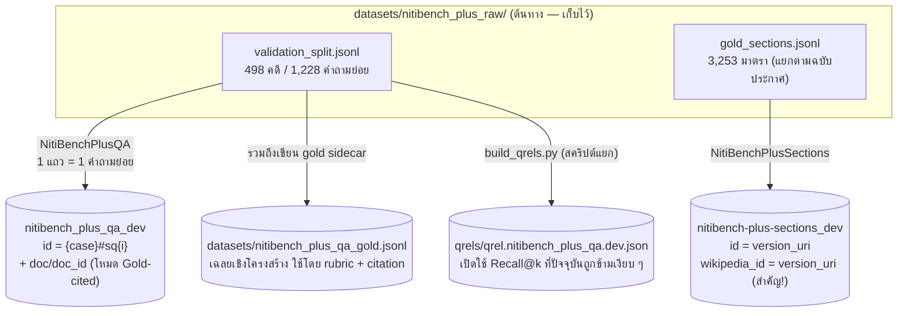
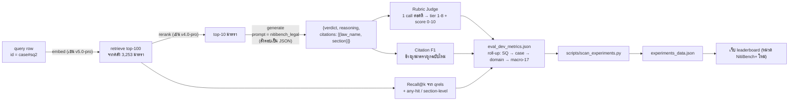

# NitiBench+ บน Thai RAG Benchmark (BERGEN-TH)

> **สถานะ**: **Phase A+B+C+D เสร็จแล้ว 2026-11-03**
> - **A (data prep)**: processor/คลัง/qrels/sidecar ผ่าน gate (1,228 query rows / 3,253 doc rows / 2,744 qrel pairs)
> - **B (prompt + retrieval pilot)**: `config/prompt/nitibench_legal.yaml` + pilot QWEN3-EMBED-8B top-100 ผ่าน gate — **version any-hit Recall@100 = 94.2%** (Recall@10 = 71.6%), version/section gap เล็ก (~0.3%) → retriever แยกฉบับเวลาดี; `scripts/nitibench/recall_report.py` พร้อมใช้เทียบ embedder ตัวอื่น
> - **C (rubric judge + Citation F1)**: `models/evaluators/niti_rubric.py` (official prompt verbatim, 1 call/คดี, checkpoint resume ได้) + `models/evaluators/citation_f1.py` (identifier/fuzzy mode, resolve เวอร์ชัน ณ วันพิพากษา) + flag `--rubric`/`--citation` ใน `evaluate.py` — pilot 75 แถว/31 คดี (RAG: QWEN3-EMBED-8B + DEEPSEEK-V4.1F, judge: KIMI-K3) **ผ่าน gate**: judge parse 100%, model-answer JSON 100% (unparseable=0), tier↔score ครบ 75/75 — ผล pilot: **bar_standard 5.82/10, Citation F1 micro 0.416 / macro 0.455** (hallucinated 41 นับแยก ตามเกณฑ์ทางการ) บทเรียน: judge ชอบตอบ JSON ถูกแต่ครอบหลายแบบ (object เดียว / `{results:[...]}` / `{grades:[...]}`) → parser รองรับ wrapper ครบแล้ว
> - **D (sweep plumbing + เว็บ)**: `scripts/run_sweep.py` รองรับ `prompt`/`generator_max_new_tokens` override + eval รวม `--rubric --citation` ครั้งเดียวต่อ run; `nitibench_sweep_config.yaml` (RAG/Parametric/Gold-cited/Cohere disabled runs พร้อม Phase E); pilot end-to-end ผ่าน sweep จริง (experiment `e64e73bc8d536231`, 75 แถว/31 คดี, 23 นาทีรวม eval+auto_scan): **bar_standard 6.33/10, Citation F1 0.420, unknown 3/31 คดี (judge nondeterminism ไม่ใช่ parser)** — บทเรียนสำคัญ: รันเดิมซ้ำที่ retrieval เหมือนเป๊ะได้ bar 5.89 vs 6.33 → **judge noise ~0.4–0.5/10** ใส่เป็น caveat บนเว็บแล้ว; เว็บได้ toggle 2 โหมด "Wikipedia V4 | NitiBench+ RAG" (`site/src/lib/nitibench-data.ts` + `NitiBenchTable/Card/Caveats` — จัดอันดับด้วย bar_standard + Citation F1 + Recall@k, **EM/F1 ไม่แสดง** แต่ยังเก็บในข้อมูล), `tsc --noEmit` สะอาด (error ที่เหลือ = package ขาดใน node_modules ของ container นี้ มีมาก่อนแล้ว)
> Phase E ด้านล่างคือขั้นตอนที่จะทำต่อ
> ต้นทางข้อมูลอยู่ที่ `datasets/nitibench_plus_raw/` (สำเนาของ [VISAI-AI/nitibench-plus](https://huggingface.co/datasets/VISAI-AI/nitibench-plus))

## ทำไมต้องมี NitiBench+

Benchmark ปัจจุบันของเราเป็น Thai Wikipedia QA (การันตีความจำ/การค้นคืนข้อมูลทั่วไป) NitiBench+ เพิ่ม **โดเมนกฎหมายไทยที่ยากกว่า** — คำถามสร้างจากคำพิพากษาคดีจริงของศาลฎีกา (368 คดี), ศาลปกครองสูงสุด (116) และศาลรัฐธรรมนูญ (14) โจทย์แต่ละข้อมี **คำพิพากษา, เหตุผลของศาล และมาตราที่ศาลยกมาปรับกฎ** พร้อมเกณฑ์ให้คะแนนตามข้อบังคับสอบวิชาชีพทนายความของทนายความสภา (Thai Bar Council 8-tier rubric) และเกณฑ์ Citation F1 แบบเป็นทางการจากชุดข้อมูลเอง

ข้อที่ทำให้ "ยากกว่า" wiki:

| | Thai Wiki QA (ปัจจุบัน) | NitiBench+ (จะเพิ่ม) |
|---|---|---|
| โจทย์ | คำถาม fact เกี่ยวกับวิกิพีเดีย | คำถามวินิจฉัยจากข้อเท็จจริงคดี (มีคำถามต่อเนื่อง `depends_on_previous` 394 ข้อ) |
| คลังเอกสาร | บทความวิกิพีเดีย | มาตรากฎหมาย 3,253 ฉบับตามช่วงเวลา (1,602 มาตราเฉพาะตัว, 1,132 มาตรามีหลายฉบับ) |
| กับดักเวลา (temporal trap) | ไม่มี | กฎหมายเปลี่ยนตามปีประกาศ — ต้องตอบด้วยฉบับที่มีผลใช้บังคับ "ในวันพิพากษา" |
| การตรวจ | lexical EM/F1 + judge คุณภาพคำตอบ | 8-tier rubric 0–10 (ผิดคำพิพากษา = ได้สูงสุด 4) + Citation F1 + Recall@k |

**หลักคิดของการ integrate: "เครื่องเดิม เปลี่ยน 3 ชิ้น"** — pipeline เดิมทุกขั้น (embed → retrieve → rerank → generate → evaluate → leaderboard) ใช้ได้ทันที เราแค่เปลี่ยน (1) query rows (2) คลังเอกสาร (3) ตัวตรวจคะแนน

สถิติชุดข้อมูล (ตรวจนับจากไฟล์จริงแล้ว): **498 คดี / 1,228 คำถามย่อย / 17 โดเมน** (โดเมนละ 27–30 คดี), drift bands: nodrift 143 / amended 223 / repealed 132 คดี, การอ้างอิงที่ไม่อยู่ในคลัง (out-of-corpus) 194 รายการ (ตรวจด้วย rubric เท่านั้น) คำถามย่อยที่ไม่มี citation ในคลังเลย 5 ข้อ และ **คำถามย่อยที่ไม่มี citation แบบ load-bearing ในคลัง 13 ข้อ** (8 ข้อส่วนเพิ่มมีเฉพาะ background) — 13 ข้อนี้ต้องใส่ sentinel `<qid> → __out_of_corpus__` ตอนแปลงข้อมูล (sanity check ของ BERGEN ปฏิเสธ list ว่าง) และถูกข้ามออกจาก qrels → ตรวจด้วย rubric เท่านั้น ตรงกับเงื่อนไข "scored on the rubric only" ของ official (สร้างจริงแล้ว: qrels 1,215 ข้อ / 2,744 มาตราเป้าหมาย)

---

## ภาพรวม: การแปลงข้อมูล (ทำครั้งเดียว)



สิ่งที่ต้องระวัง 2 อย่างที่สุ่มเสี่ยง "พังแบบไม่มี error":

1. **คอลัมน์ `wikipedia_id`**: โค้ด retrieval eval (`modules/rag.py:345`, `:413`) แม็ป id ผ่าน `wikipedia_id` เสมอ — คลังไม่มีคอลัมน์นี้ = Recall ออก 0 โดยเงียบ เราจึงใส่ `wikipedia_id = version_uri` ให้คลังกฎหมายด้วย (เลียนแบบ ThaiWikiV4)
2. **ไฟล์ qrels**: ปัจจุบัน wiki dataset ไม่มี qrels เลย ทำให้ Recall@k ถูกข้ามไปโดยไม่มี error — NitiBench+ ต้องสร้างไฟล์นี้ และต้องสร้างจาก **สคริปต์แยก** (`scripts/nitibench/build_qrels.py`) เพราะ processor มี cache ที่ข้าม `process()` ในการรันครั้งถัด ๆ ไป

## ภาพรวม: การรัน end-to-end



---

## ตัวอย่างจริง end-to-end: คดีฎีกาที่ 725/2529

คดีเดียวนี้ครบทุกอย่างที่ต้องเจอ: หลายคำถามต่อคดี, คำถามต่อเนื่อง, การอ้างหลายมาตรา และ temporal trap ในคำถามที่ 3 (ทุกข้อมูลด้านล่างดึงจากไฟล์จริง)

**คดี**: `civil_commercial::deka::725-2529` — ศาลฎีกา, โดเมน civil_commercial, พิพากษา 1986-01-01, drift_band = amended
**ข้อเท็จจริง (ย่อ)**: โจทก์ขายรถยนต์ให้จำเลยที่ 1 แบบผ่อนชำระ ("สัญญาซื้อขายมีเงื่อนไข") จำเลยที่ 2 ค้ำประกัน กรรมสิทธิ์จะโอนเมื่อชำระครบ ระหว่างผ่อนไม่ครบ รถถูกคนร้ายลักไป โจทก์บอกเลิกสัญญาแล้วฟ้องเรียกราคาคงค้างพร้อมดอกเบี้ย 15% ต่อปีตามสัญญา
**คำถามย่อย 3 ข้อ**:

| # | คำถาม (ย่อ) | มาตราที่ศาลอ้าง (gold) | หมายเหตุ |
|---|---|---|---|
| sq1 | สัญญานี้เป็นสัญญาเช่าซื้อหรือซื้อขายมีเงื่อนไข? | ป.พ.ฎ. **ม.459, ม.572, ม.574** (ฉบับ 1978) | 3 gold docs |
| sq2 | ข้อสัญญาให้ผู้ซื้อยังต้องรับผิดแม้รถสูญหาย มีผลอย่างไร? | ป.พ.ฎ. **ม.372 วรรคแรก** (ฉบับ 1978) — มาตราเดียว | ตัวอย่างเดินหลักของเอกสารนี้ |
| sq3 | คำวินิจฉัยให้ดอกเบี้ย 15% ต่อปีถูกต้องหรือไม่? | ป.พ.ฎ. **ม.391, ม.224** (ฉบับ 1978) | ม.224 ฉบับ 1978 = ดอกเบี้ย 7.5%/ปี — **ฉบับปัจจุบัน (2025) เปลี่ยนสูตรแล้ว** = temporal trap |

### 1) แปลงเป็น query rows (ผลลัพธ์ของ processor)

สำหรับ sq2 — รวมข้อเท็จจริง + วันพิพากษา + คำถาม (+ คำถามก่อนหน้า เพราะ `depends_on_previous: true`):

```json
{
  "id": "civil_commercial::deka::725-2529#sq2",
  "content": "ข้อเท็จจริง: โจทก์ (ผู้ขาย) ทำหนังสือสัญญา… (fact_pattern เต็ม)\nวันพิพากษา: 1986-01-01 (ตอบด้วยกฎหมายที่มีผลใช้บังคับในวันนี้)\nคำถามก่อนหน้า: ข้อสัญญาที่กำหนดให้ผู้ซื้อยังต้องรับผิดตามสัญญา…",
  "label": ["บทบัญญัติดังกล่าวนี้มิใช่กฎหมายอันเกี่ยวด้วยความสงบเรียบร้อย… สัญญาข้อ 4 จึงไม่ตกเป็นโมฆะ (คำพิพากษา + เหตุผลเต็มของศาล)"],
  "ranking_label": [["th/law/ป0003-1D-0002/section-372/v/1978-12-26"]],
  "doc": ["(ถ้อยคำมาตรา 372 ฉบับ 1978-12-26 — ใช้เฉพาะโหมด Gold-cited)"],
  "doc_id": ["th/law/ป0003-1D-0002/section-372/v/1978-12-26"]
}
```

- `label` = verdict + reasoning ของศาล (ใช้เป็น context ให้ prompt และเป็นข้อมูล lexical ประกอบ — คะแนนหลักไม่ได้มาจาก EM/F1)
- `doc`/`doc_id` = มาตรา load-bearing **ฉบับที่มีผลในวันพิพากษา** (1978) — โหมด RAG ปกติไม่ใช้คอลัมน์นี้เลย
- คำถามย่อยที่ไม่มี citation แบบ load-bearing ในคลัง (13 ข้อในทั้งชุด) จะได้ sentinel `['__out_of_corpus__']` เพราะ sanity check ของ BERGEN ปฏิเสธ list ว่าง

### 2) คลังเอกสาร + qrels

แถวคลังเป้าหมาย (1 ใน 3,253) — สังเกต `wikipedia_id` ที่ต้องมี:

```json
{
  "id": "th/law/ป0003-1D-0002/section-372/v/1978-12-26",
  "content": "อ้างอิง: ประมวลกฎหมายแพ่งและพาณิชย์ มาตรา 372\nมาตรา 372 นอกจากกรณีที่กล่าวไว้ในสองมาตราก่อน ถ้าการชำระหนี้ตกเป็นพ้นวิสัย…",
  "wikipedia_id": "th/law/ป0003-1D-0002/section-372/v/1978-12-26"
}
```

ในคลังเดียวกันมี **distractor ของจริง** — มาตราอื่นของ ป.พ.ฎ. เอง (เช่น ม.1015 ว่าด้วยนิติบุคคลห้างหุ้นส่วน ฉบับ 2021/2025) และ ม.372 ฉบับปีอื่นถ้ามีการแก้ไข — retriever ต้องแยก "ถูกมาตรา + ถูกฉบับ" ออกจาก "ถูกมาตรา ผิดฉบับ" ได้

qrels (ที่ `scripts/nitibench/build_qrels.py` เขียน):

```json
{"doc_dataset_name": "nitibench-plus-sections",
 "civil_commercial::deka::725-2529#sq1": {"…/section-459/v/1978-12-26": 1, "…/section-572/v/1978-12-26": 1, "…/section-574/v/1978-12-26": 1},
 "civil_commercial::deka::725-2529#sq2": {"…/section-372/v/1978-12-26": 1},
 "civil_commercial::deka::725-2529#sq3": {"…/section-391/v/1978-12-26": 1, "…/section-224/v/1978-12-26": 1}}
```

### 3) retrieve → rerank → generate

- **retrieve**: embed คำถาม (`content`) ดึง top-100 จาก 3,253 มาตรา → ได้ `runs/run.retrieve.top_100.…trec`
- **rerank**: คัดเหลือ top-10
- **generate** (prompt ใหม่ `config/prompt/nitibench_legal.yaml`): บทบาททนายควายไทย + "ตอบด้วยกฎหมายที่มีผลใช้บังคับในวันพิพากษาที่ระบุ" + บังคับ output เป็น JSON:

```json
{"verdict": "ข้อสัญญาข้อ 4 ไม่ตกเป็นโมฆะ ผู้ซื้อยังต้องรับผิดชำระราคาแม้รถถูกลักไป…",
 "reasoning": "…เป็นการยกเว้นบทบัญญัติมาตรา 372 วรรคแรก โดยคู่สัญญาตกลงกันเป็นอย่างอื่นได้…",
 "citations": [{"law_name": "ประมวลกฎหมายแพ่งและพาณิชย์", "section": "มาตรา 372 วรรคแรก"}]}
```

(รูปแบบ output — คำตอบจริงขึ้นกับโมเดลที่ทดสอบ)

### 4) Rubric Judge (คะแนนหลัก)

`models/evaluators/niti_rubric.py` + system prompt ทางการจาก `grading/judge_prompt.md` — **1 API call ต่อคดี** (ทั้ง 3 คำถามย่อยในคดีเดียวกัน) ตอบเป็น strict JSON list ตามลำดับคำถาม:

```json
[{"tier": 7, "score": 7.5, "justification": "The model correctly holds that clause 4 is not void… cites CCC s.372 first paragraph correctly…"}
]
```

เกณฑ์ Thai Bar Council 8 tier (จาก `grading/rubric.md`):

| คำตอบสุดท้าย \ เหตุผล | unusable | somewhat acceptable | acceptable | good | very good |
|---|---|---|---|---|---|
| **ตรงกับศาล** | T4: 0–1 | T5: 2–5 | T6: 5–6 | T7: 7–8 | T8: 9–10 |
| **ต่างจากศาล** | T1: 0 | T2: 1–2 | — | T3: 2–4 | — |

**ตอบผิดคำพิพากษา = ได้สูงสุด 4** — นี่คือเหตุผลที่ต้องใช้ rubric ไม่ใช่ judge คุณภาพทั่วไป

### 5) Citation F1

- **gold**: {ม.372 ฉบับ 1978-12-26} (เอาเฉพาะ load-bearing; background citations ถอดออกก่อนตรวจ)
- **prediction**: model อ้าง "ป.พ.ฎ. ม.372 วรรคแรก" → โหมดที่มีเอกสารให้ = จับคู่ด้วย identifier; โหมด Parametric (ไม่มีเอกสาร) = fuzzy law name (rapidfuzz WRatio ≥ 85) + ปรับ label ("มาตรา ๓๗๒" → "372", ตัด "วรรคแรก") แล้ว resolve เป็น **ฉบับที่มีผลในวันพิพากษา**
- กรณีนี้: precision = recall = F1 = **1.0**; ถ้าอ้างเพิ่ม ม.1015 มา = precision ตก; ถ้าไม่อ้างเลย = 0
- คำถามย่อยที่ gold อ้างนอกคลัง (194 รายการ) = ตรวจด้วย rubric เท่านั้น

### 6) Roll-up คะแนน

```
คะแนนรายคำถามย่อย → เฉลี่ยรายคดี → เฉลี่ยรายโดเมน (17 โดเมน) → macro-average 17 โดเมน
```

เช่น คดีนี้: rubric = mean(คะแนน sq1, sq2, sq3) → ใส่ domain `civil_commercial` → … ทั้งหมดเขียนลง `eval_dev_metrics.json` ซึ่ง `scripts/scan_experiments.py` คัดลอกทั้งไฟล์เข้า `experiments_data.json` ให้เว็บอัตโนมัติ

---

## 3 โหมดการรัน

| โหมด | retriever | เอกสารที่โมเดลเห็น | Citation matching | วัดอะไร |
|---|---|---|---|---|
| **RAG** | dense retriever + reranker | top-10 จากคลัง 3,253 | identifier | ทั้ง pipeline — คะแนนหลักของ leaderboard |
| **Parametric** | `retriever=null` | ไม่มี (ความจำโมเดลล้วน) | fuzzy (rapidfuzz) | ความรู้กฎหมายไทยในน้ำหนักโมเดล + การ hallucinate อ้างอิง |
| **Gold-cited** | `oracle_provenance` | มาตรา gold ที่แนบมาใน `doc`/`doc_id` | identifier | ความสามารถใช้เหตุผลกฎหมายเมื่อ "หาที่ถูกแล้ว" (แยกปัญหา reasoning ออกจาก retrieval) |

## Temporal trap (ตัวอย่างจริง)

sq3 ข้างบน: ศาลฎีกาพิพากษาให้ดอกเบี้ย **7.5% ต่อปี** ตาม ป.พ.ฎ. **ม.224 ฉบับ 1978-12-26** (valid_to 1990-09-26, `drift: amended`) — ส่วน `current_uri` ชี้ไปฉบับ 2025-03-25 ซึ่งเปลี่ยนวิธีคิดอัตราแล้ว โมเดลที่ตอบด้วย "กฎหมายฉบับล่าสุด" = ตอบผิดฉบับ

คลังเก็บทุกฉบับแยกกัน — เช่น พ.ร.บ.การขนส่งทางบกฯ พ.ศ. 2522 ม.102 มีถึง 4 ฉบับในคลัง (1994, 1999, 2003, 2023) ดังนั้น `version_uri` คือหน่วยเอกสาร (ไม่ใช่มาตรา) และ **decision date จะถูกฝังใน `content` ของ query row** เพราะ prompt f-string เห็นแค่ `{question}/{docs}/{label}`

Recall จึงรายงาน 3 ระดับผ่าน `scripts/nitibench/recall_report.py`:
1. **Recall@k มาตรฐาน** (pytrec_eval จาก qrels) — gold เฉลี่ย ~3 มาตรา/คำถาม ทำให้ค่า k เล็กดูต่ำ
2. **Any-hit Recall@k** — เจออย่างน้อย 1 มาตรา
3. **Section-level / version-exact** — ถูกมาตราแต่ผิดฉบับนับ section-level ได้ แต่ version-exact คือตัววัด "แยกแยะช่วงเวลา" จริง

---

## แผน Implementation (Phase A–E)

| Phase | ทำอะไร | ไฟล์หลัก | ค่าใช้จ่าย |
|---|---|---|---|
| **A** | Processor 2 ตัว + config + qrels + rapidfuzz | `modules/processors/nitibench_processor.py` (ใหม่), `config/dataset/nitibench_plus.yaml` (ใหม่), `scripts/nitibench/build_qrels.py` (ใหม่), `requirements.txt` | 0 (ไม่เรียก API) |
| **B** | Prompt กฎหมาย + retrieval pilot + recall report | `config/prompt/nitibench_legal.yaml` (ใหม่), `scripts/nitibench/recall_report.py` (ใหม่) | embedding 1 รอบ (ถูก มี cache) |
| **C** | Rubric judge + Citation F1 + ต่อเข้า evaluate.py | `config/evaluator/niti_rubric.yaml` (ใหม่), `models/evaluators/niti_rubric.py` (ใหม่), `models/evaluators/citation_f1.py` (ใหม่), `evaluate.py` (แก้) | pilot 30 คดี |
| **D** | ต่อเข้า sweep + เว็บ | `scripts/run_sweep.py` (แก้: prompt override + `--rubric`/`--citation`), เว็บ: **toggle 2 mode บน leaderboard — "Wikipedia V4" (หน้าเดิมทุกอย่าง) และ "NitiBench+ RAG"** (คะแนนหลัก = rubric + citation F1 + recall, ไม่โชว์ EM/F1) — `site/src/lib/benchmark-data.ts` + types | แทบไม่มี |
| **E** | รันจริงครบ 3 โหมด + กริดโมเดล | `nitibench_sweep_config.yaml` (ใหม่) | หลัก (API ของโมเดลที่ทดสอบ + judge 498 calls) |

จุด gate ระหว่างทาง: Phase B any-hit Recall@100 > 0.7, Phase C JSON parse rate > 95% — ไม่ผ่านจะหยุดแล้วมาคุยกันก่อน

## ข้อจำกัดที่ต้องเขียนกำกับบน leaderboard (comparability caveats)

1. **Gold-pool retrieval**: เราค้นจากคลัง 3,253 มาตรา (gold pool) ไม่ใช่คลัง 105k ฉบับของ official — ตัวเลข Recall ของเราจึงอ่านค่าเดียวกับ NitiBench+ ทางการไม่ได้
2. **Judge**: เราใช้โมเดล judge ที่เราเลือก + system prompt ทางการ — ไม่ใช่ judge ตัวเดียวกับ official leaderboard
3. **Lexical EM/F1 จะต่ำมากและไม่มีความหมายในโดเมนนี้** (คำตอบเป็นภาษากฎหมายยาว + รูปแบบ JSON) — เว็บจึงเป็น **toggle 2 mode**: "Wikipedia V4" (leaderboard เดิม สูตรเดิม ทุกอย่างเหมือนเดิม) และ "NitiBench+ RAG" (คะแนนหลัก = rubric + citation F1 + recall — **ไม่โชว์ EM/F1 ในโหมดนี้เลย**) ส่วน EM/F1 ยังถูกคำนวณตาม pipeline ปกติและอยู่ใน `experiments_data.json` แต่ไม่นำขึ้นหน้าจอโหมด NitiBench+
4. **License/Canary**: CC BY 4.0; ชุดข้อมูลมี canary GUID — ใช้เพื่อ **evaluation เท่านั้น ห้ามใช้ train**

## เก็บกวาด (ทำควบ Phase A)

- **ลบ**: `datasets/nitibench_raw/` (NitiBench ฉบับเดิม CCL/Tax ที่เคยดาวน์โหลดไปพิจารณา), `datasets/nitibench_plus_preview/` (ไฟล์ตัวอย่างระหว่างสำรวจ — ตัวอย่างที่ดีแค่นี้จบอยู่ในเอกสารนี้แล้ว), สคริปต์สำรวจชั่วคราวใน `/tmp`
- **เก็บ**: `datasets/nitibench_plus_raw/` (ต้นทางที่ processor อ่าน)
